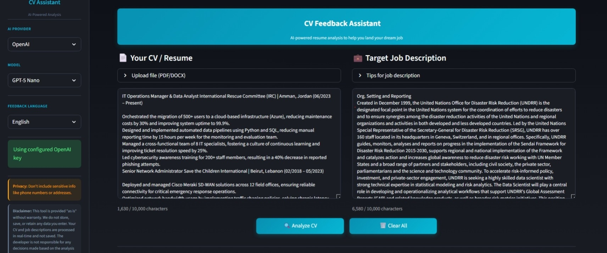
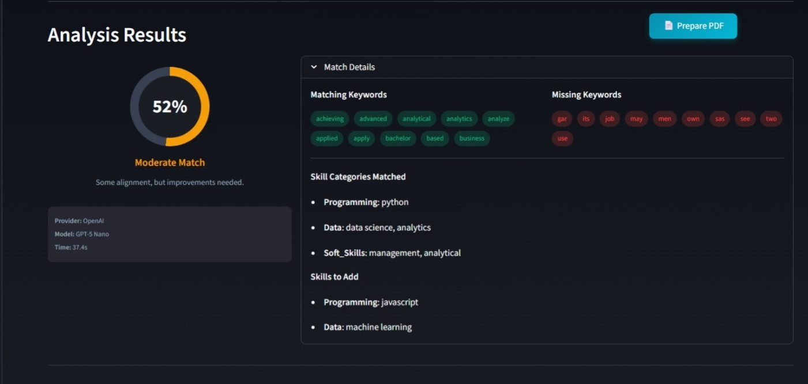
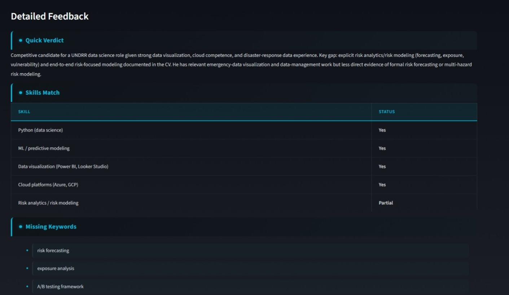
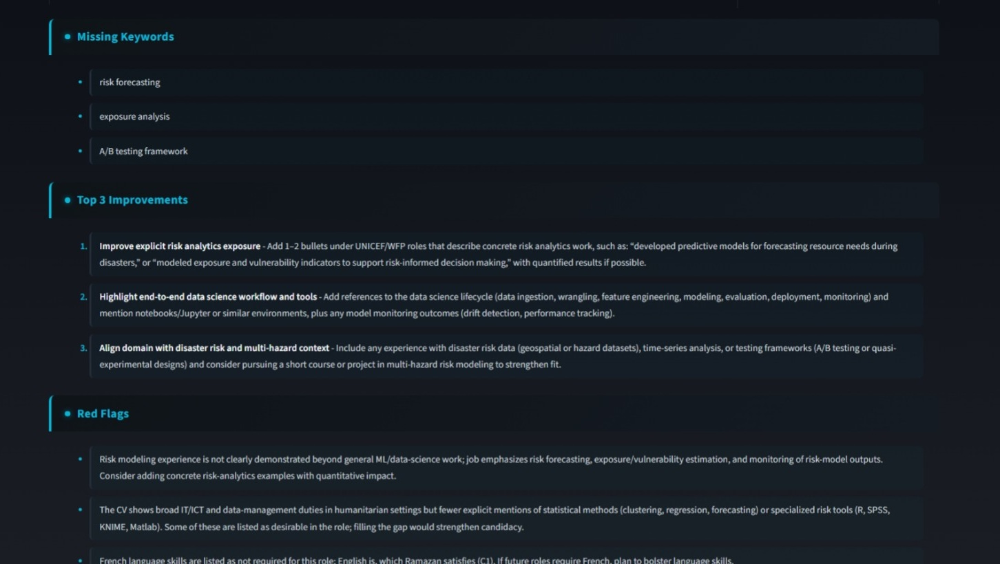

# CV Feedback Assistant

<div align="center">

**AI-powered resume analyzer that helps job seekers optimize their CVs with intelligent feedback from leading LLM providers.**


[Features](#features) • [Screenshots](#screenshots) • [Quick Start](#quick-start) • [Tech Stack](#tech-stack)

</div>

---

## What is CV Feedback Assistant?

CV Feedback Assistant is a web application that analyzes your resume against specific job descriptions using AI. It helps you understand:

- **How well your CV matches** the job requirements (with a visual score)
- **Which keywords are missing** from your resume that recruiters look for
- **What skills you should highlight** or add to improve your chances
- **Specific improvements** tailored to your target position

Simply paste your CV and the job description, select your preferred AI provider, and get instant, actionable feedback to make your application stand out.

---

## Features

### Multi-LLM Support
Choose your preferred AI provider for CV analysis:

| Provider | Models Available |
|----------|-----------------|
| **OpenAI** | GPT-5 Mini, GPT-5 Nano |
| **Google Gemini** | Gemini 3 Flash, Gemini 2.5 Flash |
| **Anthropic Claude** | Claude 4 Sonnet, Claude 3.5 Sonnet, Claude 3.5 Haiku |

### Core Capabilities

| Feature | Description |
|---------|-------------|
| **Smart Match Scoring** | Visual gauge showing how well your CV aligns with the job description |
| **Keyword Analysis** | Identifies matching and missing keywords from job requirements |
| **Skill Gap Detection** | Highlights skills you have vs. skills you need to add |
| **Actionable Feedback** | Specific, practical suggestions to improve your CV |
| **PDF/DOCX Upload** | Extract text automatically from your resume files |
| **PDF Export** | Download your analysis as a formatted PDF report |

### Multi-Language Support
Get feedback in **9 languages**:
- English, Turkish, German, French, Spanish
- Arabic, Russian, Chinese, Hindi

---

## Screenshots

### Main Interface - Dark Theme
Clean, modern UI with side-by-side CV and job description input.



### AI Provider Selection
Switch between OpenAI, Google Gemini, and Anthropic Claude with a single click.



### Match Score & Analysis Results
Visual match score gauge with detailed keyword and skill analysis.



### Detailed AI Feedback
Comprehensive feedback with Quick Verdict, Skills Match table, Missing Keywords, and actionable improvements.



---

## Quick Start

### 1. Clone the repository

```bash
git clone https://github.com/ramazankartal/cv-feedback-assistant.git
cd cv-feedback-assistant
```

### 2. Install dependencies

```bash
pip install -r requirements.txt
```

### 3. (Optional) Set up environment variables

```bash
cp .env.example .env
# Add your API keys to .env file
```

### 4. Run the app

```bash
streamlit run app.py
```

Open `http://localhost:8501` in your browser.

---

## Tech Stack

### Frontend
- **Streamlit** - Web application framework
- **Custom CSS** - Dark theme with gradient styling and animations

### Backend
- **Python 3.10+** - Core programming language
- **LangChain** - LLM orchestration framework

### Document Processing
- **PyPDF2 / pdfplumber** - PDF text extraction
- **python-docx** - DOCX text extraction
- **ReportLab** - PDF report generation
- **Markdown** - Rich text formatting

---

## Project Structure

```
cv-app/
├── app.py                    # Main Streamlit application
├── styles.py                 # Custom CSS styles
├── translations.py           # Multi-language UI translations
├── components/
│   ├── llm_selector.py       # LLM provider & language selection
│   └── feedback_display.py   # Results display with match gauge
├── services/
│   ├── llm_service.py        # Multi-LLM abstraction layer
│   ├── document_parser.py    # PDF/DOCX text extraction
│   ├── match_scorer.py       # CV-job matching algorithm
│   └── pdf_generator.py      # PDF report generation
├── screenshots/              # Application screenshots
├── .streamlit/
│   └── config.toml           # Streamlit theme configuration
├── requirements.txt
└── .env.example
```

---

## How It Works

1. **Input** - Paste your CV text or upload a PDF/DOCX file
2. **Target** - Paste the job description you're applying for
3. **Select** - Choose your preferred AI provider and feedback language
4. **Analyze** - Get instant match score and detailed feedback
5. **Export** - Download your analysis as a PDF report

---

## Privacy Note

Your data is processed in real-time and **not stored**. CV content and job descriptions are sent directly to the selected AI provider for analysis. We recommend removing sensitive personal information (phone numbers, addresses) before analyzing.

---

## License

This project is licensed under the [MIT License](LICENSE).

---

<div align="center">

**Built with Streamlit and LangChain**

</div>
